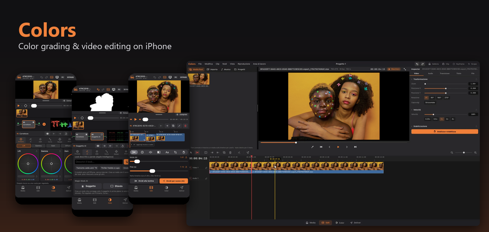
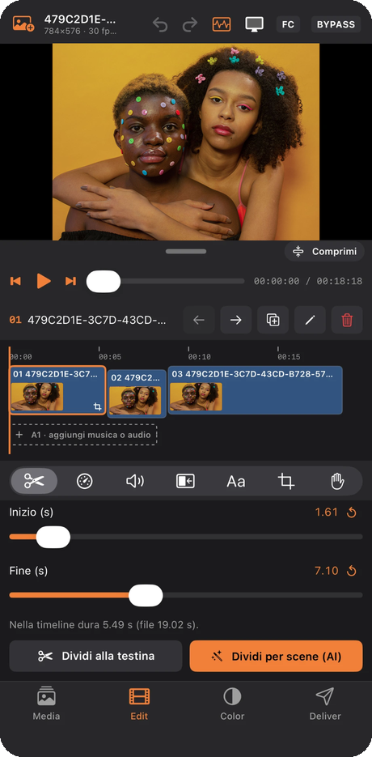
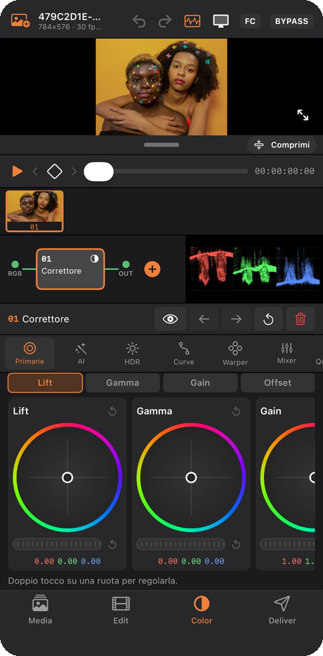
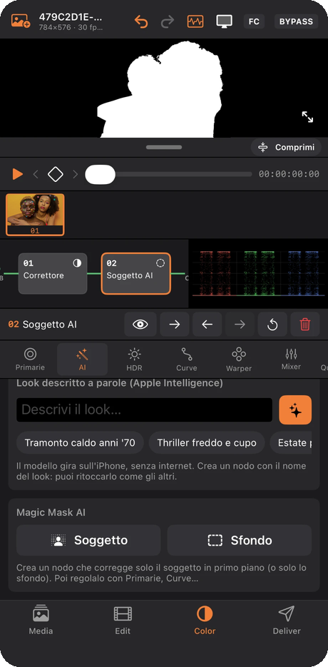
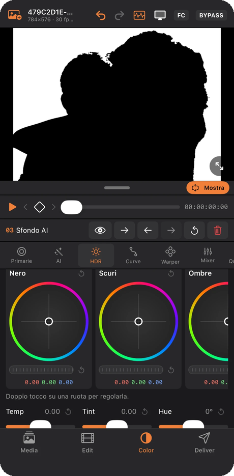
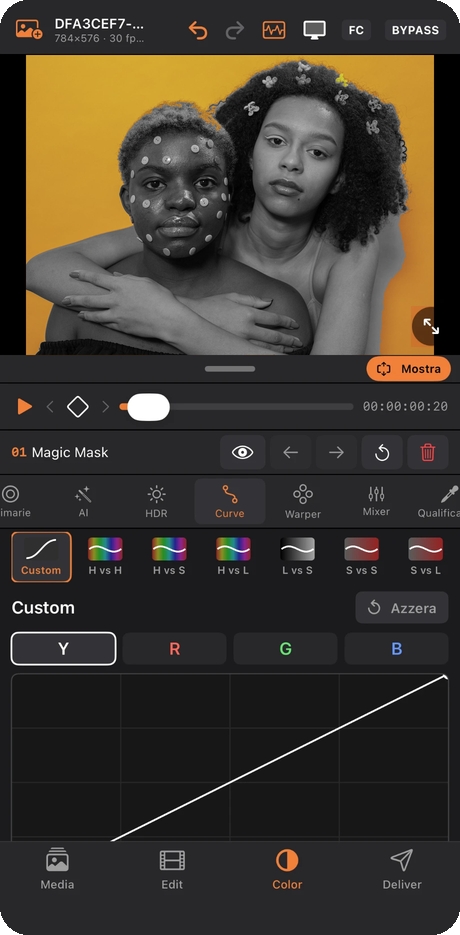
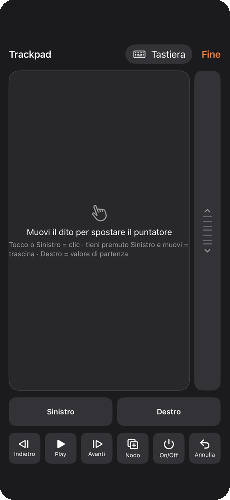
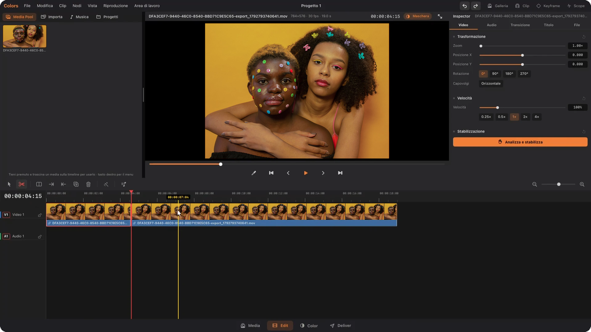
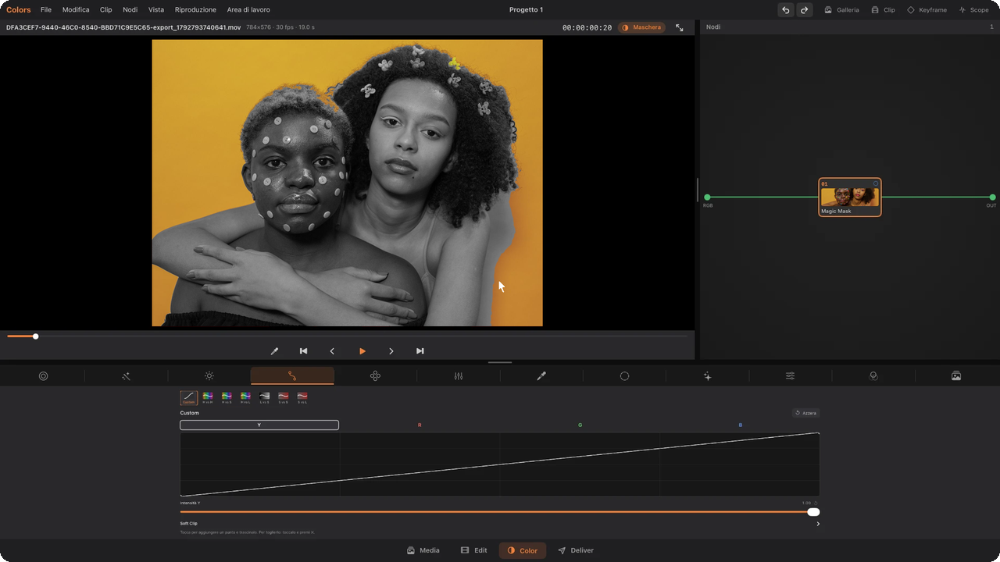
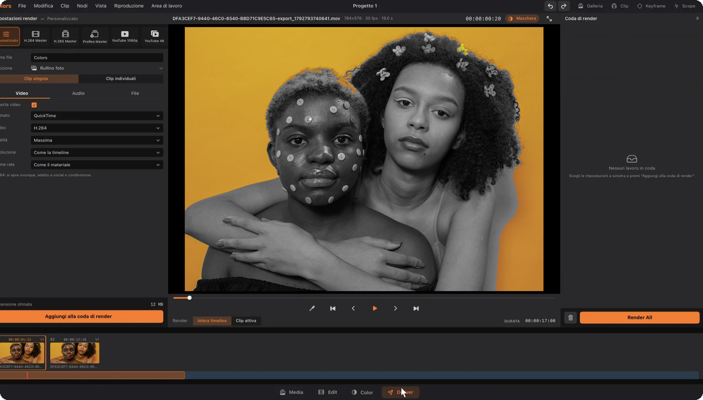

# Colors

**Colors** is an iPhone app for **color grading and video editing**, inspired by the workflow of professional post-production software (Media, Edit, Color and Deliver pages). It can be used in two ways:

- **Phone mode:** the whole app on the iPhone screen, with touch controls.
- **Monitor / AirPlay mode:** connect the iPhone to a monitor (USB‑C/HDMI cable) or to a TV/Mac via AirPlay. The monitor shows a full "desktop-style" interface, while the phone becomes a **trackpad and keyboard**. A real mouse connected through a USB hub works too.

Everything runs on the phone, offline, with no third-party libraries: Apple frameworks only (SwiftUI, Core Image, AVFoundation, Vision, Photos).

---

## Screenshots

### On the iPhone

| Edit | Color · nodes and primaries | Magic Mask (subject) |
|:---:|:---:|:---:|
|  |  |  |
| **HDR wheels on the background mask** | **Curves** | **Trackpad mode** |
|  |  |  |

### On an external monitor (USB‑C/HDMI or AirPlay)

**Edit** – Media Pool, viewer, Inspector and timeline with blade and trim tools

**Color** – node graph and curves

**Deliver** – render settings and render queue

> The screenshots were taken with an earlier build whose interface was in Italian; the current release is in English. Sample photo: [Pexels](https://www.pexels.com/photo/woman-and-man-hugging-6973754/) (free license).

---

## Download

Grab the latest **`Colors.ipa`** from the [**Releases**](../../releases/latest) page.

The IPA is **unsigned**, so you need to sign it with your own Apple ID when installing. Use a sideloading tool such as [Sideloadly](https://sideloadly.io), [AltStore](https://altstore.io) or [iloader](https://github.com/nab138/iloader):

1. Download `Colors.ipa` from Releases.
2. Open it in your sideloading tool, sign in with your Apple ID and install it on your iPhone.
3. On the iPhone: *Settings › General › VPN & Device Management* → trust your account, and enable *Developer Mode* (*Settings › Privacy & Security*).

With a free Apple ID the app must be re-signed every 7 days.

---

## Features

### Media page
- Import photos and videos from the **Photo Library**.
- Import from **Files**, from folders and from connected **USB drives** (linked folders with persistent access).
- Detects the **codec** of each file (H.264, HEVC, ProRes…) and warns when a format is not supported (e.g. Blackmagic RAW).
- **Media Pool**: imported media stay in the project, ready to be dragged onto the timeline.
- **Projects**: create, open, rename and delete projects.

### Edit page
- **Timeline** with video clips, photos and a music track, with audio waveform.
- **Blade** tool to cut clips at the exact point (with a cut line under the pointer), at any zoom level.
- **Trim** by dragging the start or end of a clip (leaving a gap, as in professional editors), **Trim to playhead**, close gaps.
- Drag media from the Media Pool onto the timeline.
- **Music**: add tracks from Music/Files/folders, cut, volume and fades.
- **Inspector**: speed, volume, framing (zoom, position, rotation, flip), transitions, titles.
- Stabilization (including "tripod" mode), automatic subject reframing, automatic captions from speech, automatic split on scene changes.

### Color page
- Serial **nodes** with preview, enable/disable and naming.
- **Primaries**: Lift / Gamma / Gain / Offset wheels (or bars), Temperature, Tint, Contrast, Pivot, Mid/Detail, Exposure, Color Boost, Shadows, Highlights, Saturation, Hue, Lum Mix, auto balance and a white-point **eyedropper**.
- **HDR**: zone wheels (Black, Dark, Shadow, Light, Highlight, Specular) with exposure, saturation and falloff, plus global controls.
- **Curves** (Y/R/G/B, Hue vs Hue, Hue vs Sat, Hue vs Lum, Lum vs Sat, Sat vs Sat, Sat vs Lum).
- Grid **Warper** on the vectorscope, using the colors from the video.
- **Qualifier** (HSL), **Windows/masks** (circle, linear…) movable directly on the video, with **tracker**.
- **RGB Mixer**, **Effects** (sharpening, grain, glow, halation, noise reduction, blur), **Color Space Transform** (Log cameras → Rec.709), **.cube LUTs** and **CDL**.
- Stills **Gallery** for comparison.
- **Scopes**: Parade, Waveform, Vectorscope, Histogram, CIE 1931.
- **Keyframes** to animate the grade.
- On-device "AI" features: auto color, looks described in words (Apple Intelligence).
- Undo / Redo.

### Deliver page
- Export presets (including social media), resolution, format, ProRes 422 HQ 10-bit or H.264/HEVC.
- **Render queue**: add several jobs and start them together.
- Save to the **Camera Roll** or to a **linked folder / USB drive**.

---

## Monitor / AirPlay mode

When the iPhone is connected to a monitor or via AirPlay:

| Monitor | iPhone |
|---|---|
| Full interface with menu bar (File, Edit, Clip, Nodes, View, Playback, Workspace), panels, viewer, timeline, scopes | Full-screen trackpad + keyboard |

- The **pointer** on the monitor is moved by the phone's trackpad or by a connected **mouse** (left/right button and scroll wheel).
- **Right click** opens context menus (nodes, clips, projects…), the **scroll wheel** scrolls lists and the timeline.
- System dialogs (file and folder pickers) and text dialogs (e.g. rename) appear **on the monitor**.
- **Full-screen** video on the monitor.
- Without a physical keyboard the phone's keyboard is used; with a connected keyboard you type directly.
- When launched with a monitor connected, a **Continue project / New project** window appears.

> Technical note: to get a real second screen (not just mirroring) the app uses a UIKit external display "companion" scene (iOS 26+). Using a mouse with left click requires AssistiveTouch to be enabled.

---

## Requirements

- iPhone with **iOS 18** or later (the separate monitor mode requires iOS 26).
- To build: a Mac with **Xcode 16** or later and an Apple ID (a free one works).

## Building

1. Open `Colorista.xcodeproj` in Xcode.
2. **Colorista** target → *Signing & Capabilities*: check *Automatically manage signing* and pick your Team.
   If the Bundle Identifier is already taken, change it (e.g. `com.yourname.Colors`).
3. Connect your iPhone, select it as the destination and press **Run** (⌘R).
4. On the iPhone: *Settings › General › VPN & Device Management* → trust your account, and enable *Developer Mode*.

Other folders:
- `Alternativa XcodeGen/` — `project.yml` to regenerate the project with XcodeGen.
- `Versione xtool (Windows)/` — the same code in the layout needed to build from Windows/Linux with [xtool](https://github.com/xtool-org/xtool).

## Code structure

| File | Contents |
|---|---|
| `ColoristaApp.swift`, `ContentView.swift`, `Pagine.swift` | App and pages on the phone |
| `Studio.swift`, `Progetto.swift`, `Sequenza.swift` | App state, projects, timeline and playback |
| `Grade.swift`, `ColorScience.swift`, `Nodi.swift`, `GrafoNodi.swift` | Color correction engine and nodes |
| `Palette.swift`, `ColorWheel.swift`, `CurveEditor.swift`, `TipoCurva.swift` | Color page palettes |
| `SchermoEsterno.swift`, `Trackpad.swift` | Monitor interface, trackpad, mouse and keyboard |
| `Cartelle.swift` | Linked folders, USB drives, codec detection |
| `Render.swift`, `Esportazione.swift`, `FormatoSocial.swift`, `Inspector.swift` | Export, render queue, Inspector |
| `Scope.swift`, `Tracker.swift`, `Stabilizzatore.swift`, `Reframe.swift`, `Sottotitoli.swift`, `CambiScena.swift` | Scopes and video analysis |
| `CubeLUT.swift`, `CDL.swift`, `AI.swift`, `LookAParole.swift`, `PannelloAI.swift` | LUTs, CDL and smart features |

## Notes

Colors is an independent project. Its interface is inspired by the layout of professional color grading software, but all the code is written from scratch. DaVinci Resolve is a trademark of Blackmagic Design; this project is not affiliated with or endorsed by Blackmagic Design.
